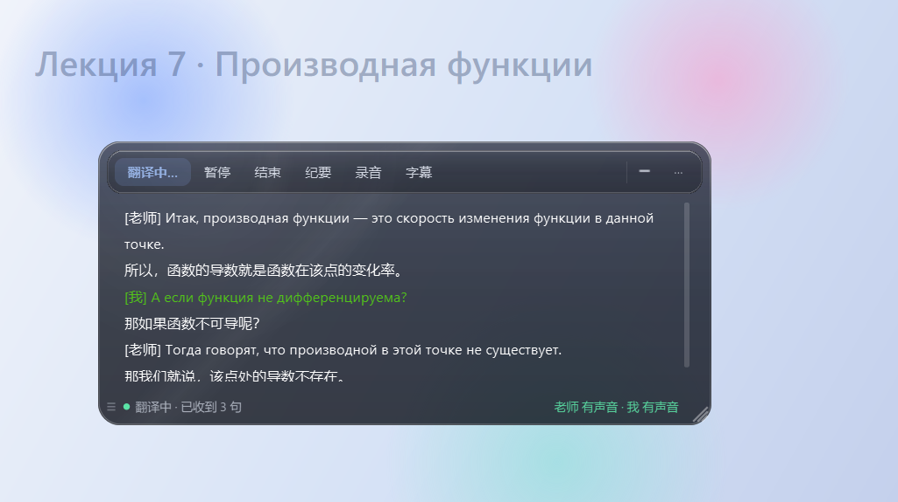
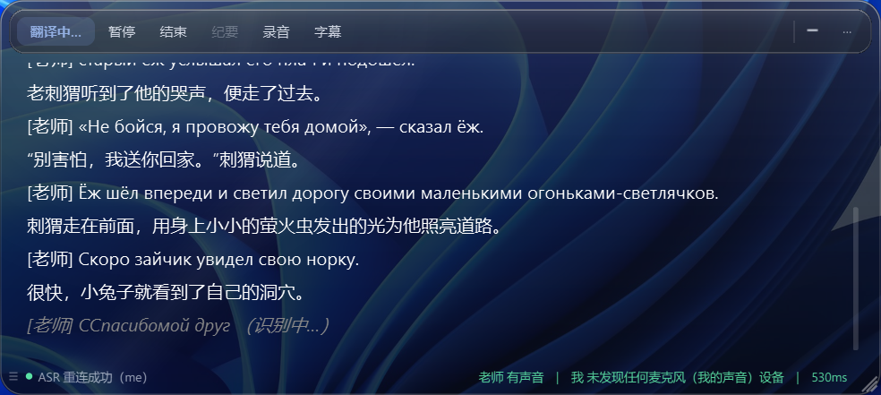
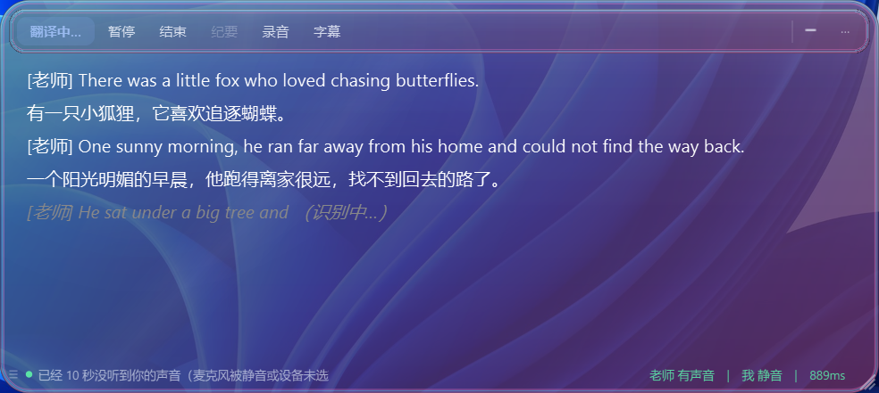
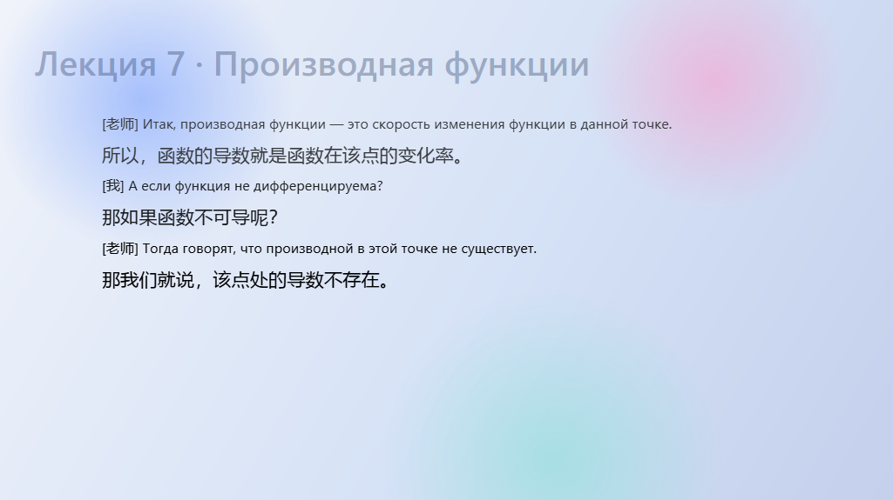
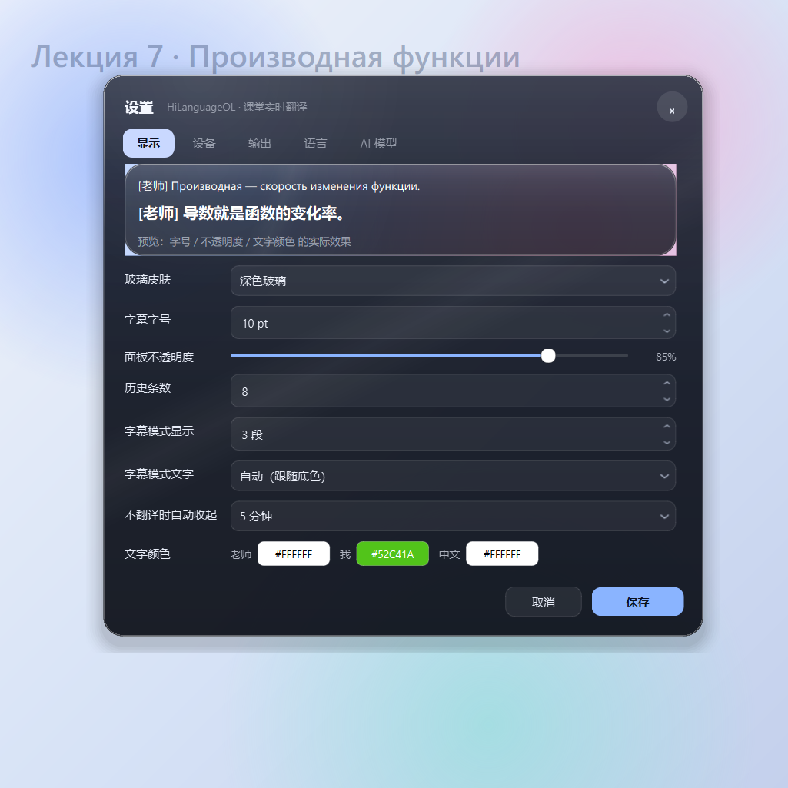

# 中英俄实时翻译软件（HiLanguageOL）

> **中 / 英 / 俄**三语实时字幕工具：抓取系统声音（和麦克风）→ 流式语音识别 → 上下文增强翻译 → 玻璃质感字幕浮窗。
>
> Windows 10/11 · Python 3.12 · PyQt6 · [GPL-3.0](LICENSE)



## 它解决什么问题

看外语网课、听外语讲座或开会时，最大的障碍是"跟不上"。这个软件把说话人的语音实时变成**原文 + 译文**，叠在画面上，不打断你操作；需要专注时一键收进托盘，字幕模式则完全去掉背景、只留文字。

支持 **中文、英文、俄语** 三种语言互译（源语言可自动检测），适合网课、讲座、线上会议等场景。

## 功能

- **实时双语字幕**：原文 + 译文成对显示，支持同时显示最近 N 段（默认 3 段）
- **中英俄互译**：中→英、英→中、俄→中、中→俄等组合，源语言可设为自动检测
- **双通道采集**：系统回环（对方/老师）+ 麦克风（自己），两个通道独立识别、各自标注
- **两种显示模式**
  - 浮窗模式：玻璃质感面板，可拖动/缩放，鼠标移入浮现工具条
  - 字幕模式：无背景、纯文字，**文字颜色自动跟随底色**（亮底黑字、暗底白字），双击返回浮窗
- **两套玻璃皮肤**：深色玻璃 / 极光玻璃
- **边听边译**：按标点/长度增量切句，不用等整段说完
- **课堂/会议留档**：录音 WAV、SRT/VTT/TXT 转写、内容纪要（markdown）
- **不打扰**：不翻译时静置自动收进托盘；全局只占一个托盘图标，无控制台窗口

实际使用（深色玻璃 / 极光玻璃）：

| 深色玻璃 | 极光玻璃 |
|---|---|
|  |  |

| 字幕模式（自动配色） | 设置页 |
|---|---|
|  |  |

## 快速开始

### 1. 准备

- Windows 10/11
- Python 3.10+（开发环境用 3.12）
- 两个 API Key：
  - **语音识别**：阿里云百炼（DashScope）或 Yandex SpeechKit
  - **翻译**：任意 OpenAI 兼容接口（默认阿里云百炼 qwen-plus）

### 2. 安装

```bat
git clone https://github.com/chengguojin1/HiLanguageOL.git
cd HiLanguageOL
python -m venv .venv
.venv\Scripts\pip install -r requirements.txt
```

### 3. 配置

首次启动会把 `config.example.ini` 复制成 `config.ini`（打包版在 `%APPDATA%\HiLanguageOL\config.ini`），把 Key 填进去：

```ini
[translate]
engine = openai
base_url = https://dashscope.aliyuncs.com/compatible-mode
model_name = qwen-plus
fallback_model_name = qwen3.6-plus
api_key = <你的翻译服务 Key>

[asr]
engine = aliyun
api_key = <你的识别服务 Key>

# 语言方向：源语言可写 ru / en / zh / auto（自动检测）
[language]
source_lang = ru
target_lang = zh
```

也可以启动后在 **设置 → AI 模型** 里填，语言方向在 **设置 → 语言** 里选。

> Key 只保存在本机 `config.ini`，不会上传到任何地方（本项目没有遥测、没有统计）。`config.ini` 已在 `.gitignore` 中，不会被提交。

### 4. 运行

```bat
start.bat
```

或：

```bat
.venv\Scripts\pythonw.exe main.py
```

点 **开始翻译**（或按 F5），把窗口拖到课件上即可。

## 常用操作

| 操作 | 方式 |
|---|---|
| 开始 / 暂停 / 结束 | `F5` / `F6` / `F7` |
| 录音模式（缩成小图标） | `F8` |
| 字幕模式 | `F9`；双击或右键退出 |
| 设置 | `Ctrl + ,` |
| 收起窗口 | 工具条 `−`，或托盘图标 |
| 拖动 / 缩放 | 底部状态条拖动，右下角缩放 |

## 打包

```bat
build.bat
```

自动完成：环境自检 → 版本号（回车自动 +1）→ PyInstaller 出 exe → Inno Setup 出安装包 → 敏感信息安检。
详见 [BUILD.md](BUILD.md)。

## 目录结构

```
main.py              入口与控制器（状态机、线程调度）
app/
  ui.py              字幕窗、设置页
  theme.py           液态玻璃皮肤与控件样式
  asr_ws.py          阿里云百炼流式识别
  asr_yandex.py      Yandex SpeechKit gRPC 识别
  translator.py      翻译管线（上下文、纠错、保序、缓存）
  audio.py           WASAPI 回环 + 麦克风采集
  session.py         录音与转写落盘
  summary.py         课堂纪要生成
  config.py          配置读写
tools/               版本号、打包安检
proto/               第三方 proto 定义（Google / Yandex）
tools/dev/           本地验证脚本（截图、冒烟测试、模型对比）
```

## 隐私与合规

- **所有录音、转写、纪要保持在本机**，项目不包含任何上报逻辑。
- 识别与翻译请求会发送到你配置的服务商（阿里云 / Yandex），请自行阅读其隐私政策。
- **录制他人课堂/会议可能涉及当地法律与平台规则**，请务必取得必要授权后再使用；因使用方式不当造成的后果由使用者自行承担。
- 本项目与阿里云、Yandex 无任何关联，API 费用由使用者自行承担。

## 第三方组件

见 [THIRD-PARTY-NOTICES.md](THIRD-PARTY-NOTICES.md)。核心依赖：PyQt6（GPLv3）、gRPC、protobuf、numpy、soundfile、requests、websocket-client、PyAudioWPatch。

## 许可证

本项目采用 **GNU General Public License v3.0**，见 [LICENSE](LICENSE)。

原因：界面基于 PyQt6，其开源授权为 GPLv3；因此本项目整体以 GPLv3 发布。

你可以自由使用、修改、分发（包括商业用途），但分发修改版时必须同样以 GPLv3 开放源代码，并保留版权声明。

## 免责声明

软件按"现状"提供，不附带任何明示或暗示的担保。因使用本软件导致的课程内容、账号、数据或设备问题，作者不承担责任。

---

Copyright (C) 2026 chengguojin · 以 GPL-3.0 授权（见 [LICENSE](LICENSE)）
